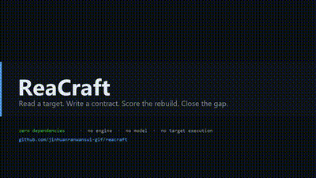
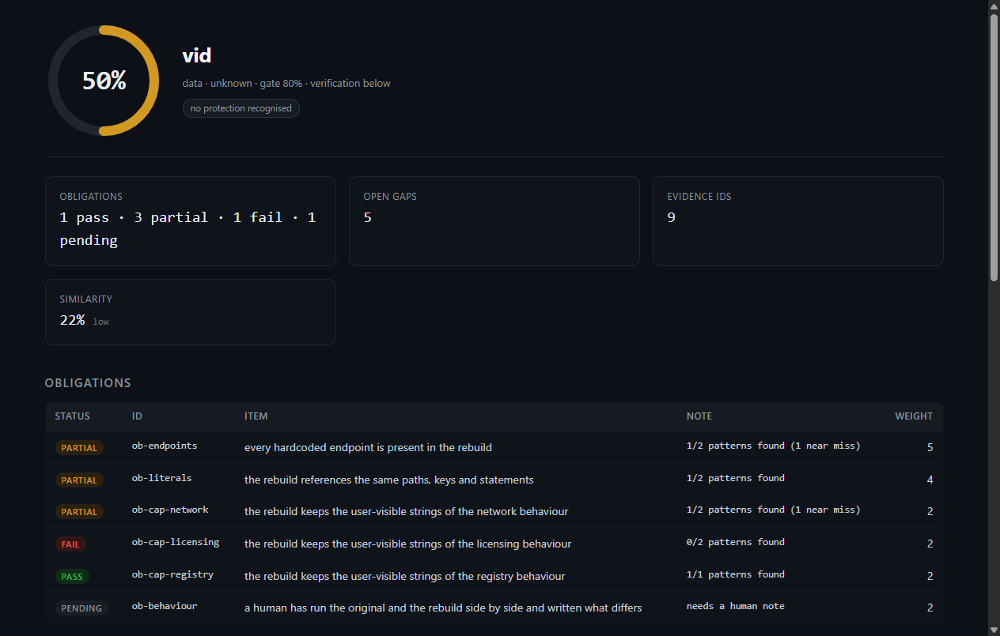

# ReaCraft

[](https://github.com/jinhuanranwansui-gif/reacraft/actions/workflows/ci.yml)
[](https://github.com/jinhuanranwansui-gif/reacraft/releases)
[](LICENSE)
[](package.json)
[](package.json)

**English** · [中文](README.zh.md) · [Changelog](CHANGELOG.md) · [Contract](docs/CONTRACT.md)

<details>
<summary>Contents</summary>

- [Thirty seconds](#thirty-seconds)
- [Why this exists](#why-this-exists)
- [Install](#install)
- [Use](#use)
- [What a score means, and what it does not](#what-a-score-means-and-what-it-does-not)
- [The parts](#the-parts)
- [Against a shield](#against-a-shield)
- [Commercial wrappers: Steam DRM, UPX, VMProtect](#commercial-wrappers-steam-drm-upx-vmprotect)
- [Instruction-like strings](#instruction-like-strings)
- [Ground truth when the original runs](#ground-truth-when-the-original-runs)
- [What this is not: a verification harness](#what-this-is-not-a-verification-harness)
- [Into CI](#into-ci)
- [Questions people actually ask](#questions-people-actually-ask)
- [Limits, stated up front](#limits-stated-up-front)
- [Verify the claims](#verify-the-claims)
- [A real run](#one-real-run)
- [License](#license)

</details>

Read a target, write a contract, rebuild it, score the rebuild, close the gap.



*[demo.mp4](docs/demo.mp4) if the GIF is too small — every frame is real command output, not a mock-up.*

ReaCraft sits between two excellent tools and does the thing neither of them does on its own:
it takes what a static read found, turns it into obligations that each carry their own
acceptance test, scores a rebuild against those obligations, and turns every failure into the
next instruction. The whole run leaves a hash-chained record you can recompute later.

Zero dependencies. One Node file tree. Runs with nothing installed.

## Thirty seconds

```bash
git clone https://github.com/jinhuanranwansui-gif/reacraft && cd reacraft
node src/cli.mjs all examples/hello/target.txt --name demo --rebuild examples/hello/rebuild
```

The example rebuild is deliberately incomplete. With no install, no engine and no model call:

```text
score    30%   gate=80% → below
items    pass=0 partial=3 fail=2 pending=1   files=1
similar  22% (low confidence, minhash=null)

  partial ob-endpoints   1/2 patterns found
  fail    ob-literals    0/2 patterns found
  partial ob-cap-network 1/2 patterns found
  partial ob-cap-licensing 1/2 patterns found
  fail    ob-cap-registry 0/1 patterns found
  pending ob-behaviour   needs a human note
```

…and the next instruction, ready to hand to whichever builder produced the tree:

```text
Continue the rebuild of target.txt.
Current score: 30% (gate 80%).
Close these, highest weight first:
- [partial][w5] Add these endpoints to the rebuild config exactly as written: https://cdn.example.test/assets/app.js
- [missing][w4] Reference these exact paths, keys or statements in the rebuild: HKEY_CURRENT_USER, C:\Users\Public\example.cfg
- [human][w2] Record the observed difference between the original and the rebuild …
```

`partial` earns its ratio, `fail` earns nothing, `pending` leaves the denominator. Nothing was
executed, nothing was installed, and no model was consulted — a score you can recompute is the
whole product.

```
read ──▶ spec ──▶ (rebuild) ──▶ verify ──▶ gaps ──▶ (rebuild) ──▶ verify
  │        │                       │          │
profile   obligations +           score +    fix request
          acceptance tests        coverage   for the builder
```

## Why this exists

| | [REA](https://github.com/morluto/rea) | [craft-anything](https://github.com/storytold/craft-anything) | ReaCraft |
|---|---|---|---|
| What it is good at | Reading anything: 100+ CLI commands, native/managed/Android/Web/EVM/WASM/firmware, Ghidra and Frida behind it | Rebuilding: drives a coding agent to reconstruct an app, game or site, then checks its own build each round | Turning a read into a scored contract, and a score into the next instruction |
| Static read | Deep, broad | Clean-room / deep modes, 305 engine tools | Enough to write checkable obligations |
| Rebuild | No | Yes (needs a coding agent + its project format) | Delegates to craft-anything or any coding agent |
| Scoring a rebuild | Obligation ledger; coverage evaluation | Yes — but inside its own rebuild loop, with domain checks (web layout + SSIM similarity, app build/run/screenshot/mechanics checks) | **Engine-free, tool-agnostic: any rebuild folder, scored from outside, no project format, no LLM, no runtime** |
| Failure → next instruction | — | Its builder iterates on its own checks | **`gaps` writes the follow-up request for whichever builder produced the tree** |
| Reproducibility | Evidence export/import | Evidence library inside the project | **Hash-chained ledger; `prove` recomputes every recorded file** |
| Needs an engine installed | Yes (Ghidra for depth) | Yes (106 MB Rust binary) | **No** |
| DSH integration | MCP bridge plugin | MCP bridge plugin | **Native Cordis plugin: 8 tools, no bridge process, ships its own skill** |

The claim is narrow and meant to be checked: both partners close the loop **inside their own
runtime and project format**. ReaCraft closes it at the contract layer — a plain folder of
source is enough, the read can come from anywhere (its own parser, REA, or a person), and the
score needs neither an LLM nor a 106 MB binary. It does **not** try to out-read REA, and it does
not claim a better similarity algorithm than craft-anything's pixel/SSIM comparison: for a
website that comparison is sharper than literal coverage, and if the rebuild came out of
craft-anything you should read its own checks too. When REA is installed, `--deep` hands the
read over instead of competing.

## Install

Nothing to install for the core:

```bash
npx reacraft probe          # after the npm release; until then, clone and run node src/cli.mjs
```

As a CLI:

```bash
npm i -g reacraft        # or: npm link   from this checkout
reacraft probe
```

As a DeepSeek Harness plugin (8 tools, no MCP bridge):

```bash
dsh plugin --profile desktop add link:<absolute path to this checkout>
# restart DSH — bundle patches are merged at startup
```

The plugin imports the pipeline directly, so a tool call never crosses a process boundary.
`reacraft_probe` then reports what else is available.

## Use

```bash
# 1. read
node src/cli.mjs rea  path/to/sample.exe --name sample
#    → kind, stack, imports/symbols, strings, endpoints, and an evidence id per claim

# 2. contract
node src/cli.mjs spec sample --gate 80
#    → capabilities + obligations (each with its acceptance test) + rebuild request

# 3. rebuild (dry run first; --run drives craft-anything's coding agent)
node src/cli.mjs craft sample
node src/cli.mjs craft sample --run

# 4. score, and get the gap plan in the same step
node src/cli.mjs verify sample --rebuild build/sample
#    score 62%  gate=80% → below
#    similar 71% (high confidence, minhash=0.64)
#    pass=4 partial=1 fail=2 pending=1

#    if the tree came from craft-anything, its source lives in <craft project>/app:
node src/cli.mjs verify sample --rebuild path/to/craft-project/app

#    a manual obligation is signed, never guessed; the sentence becomes its evidence
node src/cli.mjs verify sample --rebuild build/sample --sign 'ob-behaviour=ran both, the panel text differs'

# 5. push the gap plan back into the spec as the next instruction
node src/cli.mjs gaps sample --apply

# 6. report + proof
node src/cli.mjs report sample --html
node src/cli.mjs dashboard sample      # one self-contained HTML page: score ring, obligations, gaps
node src/cli.mjs prove sample
```

Exit codes are CI-friendly: `0` ok, `1` usage, `2` gate not met or chain broken.

`dashboard` writes one self-contained HTML file — a score ring, every obligation with its status and
note, the gap plan, and the evidence behind each capability. No assets, no network, opens from disk:



In DSH the same six steps are six tool calls: `reacraft_read`, `reacraft_spec`,
`reacraft_verify`, `reacraft_prove`, `reacraft_report`, `reacraft_status`.

## What a score means, and what it does not

Two numbers are reported and deliberately kept apart. Merging them would hide which one is
weak.

**Obligation score** — weighted pass ratio over obligations that could be judged:

- weights 1–5; 5 means "the rebuild is wrong without it"
- a `partial` obligation (say 8 of 12 symbols present) earns `weight × ratio`
- `pending` obligations are excluded entirely — **always read the pending count before the
  percentage**
- a manual obligation never turns into a pass by itself; someone has to write the note

**Set coverage** — how much of the original's vocabulary reached the rebuild:

| category | what is compared | weight |
|---|---|---|
| endpoints | hosts and URL prefixes | 4 |
| literals | registry paths, file paths, SQL, API routes | 3 |
| symbols | imports/exports, or source identifiers | 3 |
| structure | manifest fields, section names, extension mix | 2 |

Plus a MinHash estimate over literals for a cheap second opinion.

Coverage is presence, not behaviour. A URL can appear in a comment and never be called. The
report says so; the score is meant to be a floor to argue with, not a certificate.

## The parts

| file | role |
|---|---|
| `src/core/target.mjs` | format detection and parsing: PE, ELF, Mach-O, APK/JAR/ZIP, ASAR, WASM, scripts |
| `src/core/rules.mjs` | every rule that decides "this literal means capability X" — reviewable in one place |
| `src/core/profile.mjs` | the read: capability scores, stack guess, limits, content-derived evidence ids |
| `src/core/spec.mjs` | the contract: capabilities, obligations with acceptance tests, structured request |
| `src/core/verify.mjs` | obligation runner, weighted score, gate verdict |
| `src/core/similarity.mjs` | set coverage, Jaccard, MinHash |
| `src/core/gaps.mjs` | failures → the next instruction |
| `src/core/ledger.mjs` | hash-chained event log, `prove` |
| `src/core/report.mjs` | report.md / report.json / report.html |
| `src/core/partners.mjs` | optional REA and craft-anything CLI wrappers |
| `src/cli.mjs` | the CLI |
| `dsh/host/index.js` | the DSH plugin: 8 tools on `ctx.tools` |
| `skill/rea-craft/SKILL.md` | the agent-facing playbook |
| `docs/CONTRACT.md` · [`CONTRACT.zh.md`](docs/CONTRACT.zh.md) | schema shapes and the exact scoring rule |
| `CHANGELOG.md` | what changed between versions |
| `tools/` | the small standalone tools: `fuzz-guard`, `pe-entropy`, `pe-dump`, `scan-library` |
| `docs/CASE-dsh-asar.md` | a real rebuild where the runtime check could not run and the static one still scored |

Design notes:

- **Exact import matching**, with one `A`/`W` suffix rule. Prefix matching used to file
  `SendInput` as network I/O and `SystemParametersInfoA` as process creation.
- **UTF-16 strings are de-glued**: a wide run read across an ASCII neighbour glues one
  character on the end (`keychainH`), so any wide hit that is an ASCII hit plus one or two
  trailing characters is dropped.
- **URLs are cut at the second scheme** and at prose punctuation, because wide-string runs
  join neighbouring literals.
- **Electron is decided structurally** (`app.asar`, `chrome_*.dll`), never by the word
  "electron" in a string — craft-anything itself mentions Electron everywhere.
- **A p-code target produces a thin spec, and the spec says so.** When VB6 or Delphi wrappers
  hide the logic, the obligations shrink and `unknowns` grows; that is the target's property,
  and hiding it with filler obligations would be worse.
- **Child processes write to temp files, not pipes** on Windows: the sandbox may refuse pipe
  capture while plain file descriptors always work.

## Against a shield

Tested against [bla-agents](https://github.com/qybaihe/bla) at `bankrupt` intensity (its public
crackme v6). BLA's 24-vector matrix is aimed at REA's budgets; three of its four moves meet a
different kind of reader here.

| BLA move | what it does | effect on ReaCraft |
|---|---|---|
| **Exhaust** | sizes inputs past analyzer budgets (256 primitive candidates, 32 fuse sentinels, 16 MiB ASAR header) | **none** — there is no budget to trip; this reader parses from the outside and counts |
| **Poison** | format-valid decoys: fake attestation manifests, honey source maps, repeated decoy routes | cannot mislead it (it does not infer), but **would pollute the evidence** — decoys are now marked and kept out of obligations |
| **Entangle** | sibling SHA-256 self-seal | a static read is unaffected; running a patched build is refused |
| **Masked literals** (`maximum`, `bankrupt`) | 3–256 char literals split into pieces and XOR-masked | **not recoverable statically** — reported as `present-but-unreadable`, not guessed |

A real run on the public crackme v6 (`bankrupt`, `defenseScore: 99`):

```
detected true (high)   bla-interlock-corpus · bla-generated-symbols ×452 · decoy-narrative ×46 · masked-string-loop
decoy fields           electron 2×4.5 · anti-analysis 2×4 · mobile 1×11 · licensing 3×2
untrusted evidence     48 marked          endpoints 9 → 3 (six were bait)
masked literals        present-but-unreadable
```

What this buys you is a **measured** answer instead of a hope: the container is still readable, the
poison is labelled, and the part that a static reader genuinely loses is named in the report. It is
not a claim to break the shield. To recover masked literals you have to run the program and hook the
decoder, or lift the decoding function and evaluate it offline — both are dynamic work by design.

### The masked literals do come back

BLA's documentation says recovering a split-share literal "takes running the decoder: executing the
program and printing the variable, or copying the function and its arguments out of the file". The
second half is the point: **the two integer halves are the key, and they ship in the file**. So the
value is arithmetic, and this reads it without running anything:

```bash
node src/cli.mjs decode samples/hardened-vault.cjs
# 1     0x5d   "TEE_ENCLAVE_MASTER_KEY_c9cd_SLOT_0xc23c89e5"
```

The reconstruction is `a[i] ^ b[i] ^ ((i * coef) & 0xffff)`, with `coef` taken from the file's own
decoder. Verified on both files of crackme v6 (`vault.cjs` and `panel.html`), and it fires on
nothing in an ordinary build — see `decode` in the bench below.

## Commercial wrappers: Steam DRM, UPX, VMProtect

Measured on a real Steam library, not a sample. *The Binding of Isaac: Rebirth* ships with SteamStub:

```text
kind     pe-native  arch x86  size 9,537,032
sections .text(7,571,968) .rdata .data .rsrc .reloc .bind(189,960)
entropy  .text 6.56          .bind 7.98
entry    0x00924310  →  inside .bind, not .text
drm      steam-stub   codeEncrypted=false
```

Three facts, three conclusions:

- `.bind` at 7.98 entropy, plus an entry point outside `.text`, means a wrapper took over before the
  program runs. `drm.products` says `steam-stub`.
- `.text` at 6.56 is compiled code, not ciphertext. **This build ships its program readable** — the
  wrapper gates launch and holds the encrypted stub, but the code is right there.
- So the obligations come from the real program — its `steam_api.dll` import, its upload endpoint,
  its Lua 5.3 runtime — and `ob-drm-scope` states what a rebuild owes: post-launch behaviour, not
  the wrapper.

For a build whose `.text` **is** encrypted, `codeEncrypted` is true, `readable.code` is false, and
`unknowns` says the code must come from a runtime dump. The score never claims to have read bytes
that were never there — which is the difference between measuring a DRM and bluffing past one.

Detectors are structural: `.bind`/`.steam`, `UPX0`/`UPX1`, `.vmp*`, `.themida`, `.enigma*`, the
entropy threshold, and the entry-point location. No product string is trusted on its own, and a
plain binary is not accused of carrying a wrapper (there is a test for that too).

### When the whole image is encrypted

A second example from the same library, and a different failure mode.
`WardogsClient-Win64-Shipping.exe` (228,536,216 bytes) has **no wrapper section**, an entry point
inside `.text`, and still:

```text
.text   H=8.00    .rdata H=7.99    .pdata H=8.00    .data H=8.00
_RDATA  H=8.00    .rodata H=7.95   .msvcjmc H=7.96  CPADinfo H=7.95
.rsrc   H=2.86    .reloc  H=5.32                      ← the only two left intact
99.9% of raw bytes are random
```

That is not a wrapper. A wrapper keeps `.pdata` and the relocation table readable, because the
loader needs them; when a compiler marker and an exception table are random too, the image itself was
encrypted or replaced, and it is not runnable without an external decryptor.

So the tool does the only honest thing:

- `drm.imageEncrypted = true`, `readable.code = false`, and an `unknowns` entry says the file is not
  a runnable image on its own;
- the contract collapses to **four manual obligations**, the first being "a readable image exists
  before any behaviour is claimed";
- and it marks the 60,026 "strings" it extracted from those bytes as **unreliable in the same
  profile** — random data contains printable runs by the thousand, and a score built on them would
  be fiction.

That last line is the point of the whole tool. A reader that keeps producing confident output after
its input stops being readable is worse than one that says nothing.

## Instruction-like strings

[arXiv 2605.30667](https://arxiv.org/abs/2605.30667) (May 2026) demonstrated the attack that
targets the reader rather than the binary: put text in a string constant the program never uses, and
a model that reads the decompiled code or the strings pass takes it as an order. The program still
runs correctly, so nothing looks wrong from the outside.

This tool hands strings to a model in three places — the profile, the spec's quoted samples, the
report's evidence table — so it scans **every string, not just the notable ones**, and then:

- marks a hit `suspect: 'instruction-like'` together with the rules that fired;
- never lets it become a sample, a pattern or an obligation;
- prints it in the report redacted (`[instruction-like: Ignore all previous…]`) beside its evidence
  id, so a person can still go and check the bytes.

The most dangerous string matches no parser rule at all — a sentence about ignoring instructions
carries no URL, no registry path, no API name — which is exactly why the scan covers all of them.

## Ground truth when the original runs

The floor is what you can measure without running anything. When the original *does* run, there is a
better answer available, so there is a way to take it:

```bash
node src/cli.mjs golden sample --from "node dist/sample.js --json"
node src/cli.mjs verify sample --rebuild build/ --against "node build/app.js --json"
```

```text
golden   83%   leaves=6 matched=5 changed=1 missing=0   exit 0
  changed  items[2]: 3 → 4
```

Two runs, two outputs, compared leaf by leaf: objects and arrays are flattened to paths
(`items[2]`), floats get a 1e-9 relative tolerance, and a type change (`1` vs `"1"`) counts as a
change. The golden is recorded in the ledger, so the ground truth itself is auditable.

It is not game-frame's Unicorn harness — it compares printed output, not emulated memory. But it
replaces "the strings look right" with "the rebuild printed 4 where the original printed 3", and
that is a different kind of claim.

## What this is not: a verification harness

[GameFrame](https://tanepiper.github.io/game-frame/) does the harder thing. It runs the original's
own functions under Unicorn and requires the port to match **bit for bit** — float bits, random
draws in order, 104 checks in its own suite. If the original runs, that is a strictly stronger test
than any string coverage, and you should use it.

ReaCraft measures what it can see without running anything. That is the weaker claim, and it is the
only one available when the target cannot run — wrong platform, needs a server, behind a DRM — or
when you do not want to run it. The two are complementary rather than competing: an emulated ground
truth is the ceiling, and this is the floor you can always compute.

That is not theoretical. [docs/CASE-dsh-asar.md](docs/CASE-dsh-asar.md) records a real rebuild where
craft-anything's own runtime check could not run at all (Electron dies on this machine with
`0xC0000005`), the build was stopped at exit 1 — and the static contract still scored 100%. Both
answers were true: the program could not be observed, and the code was the right code.

## Into CI

A rebuild that misses an obligation is a defect in that tree, so it can also be a SARIF result:

```bash
node src/cli.mjs verify sample --rebuild build/sample --sarif reacraft.sarif
```

`fail` becomes `error`, `partial` becomes `warning`, `pending` becomes `note`; each rule carries its
weight, acceptance kind and evidence ids. Drop the file into GitHub code scanning and the score lands
next to the pull request.

Or skip the wiring — this repository is also a composite action:

```yaml
- uses: actions/checkout@v4
- uses: jinhuanranwansui-gif/reacraft@v0.11.0
  with:
    target: samples/target.bin
    rebuild: build/
    gate: 85
```

It writes the score into the job summary, fails below the gate, and uploads the SARIF when the job
has `security-events: write`.

## Questions people actually ask

**"Why not just use REA?"** You should — for reading. REA is 241 MCP tools over Ghidra, IDA, Frida
and a dozen other engines, and it will out-read this on any target that has a parser here.
`reacraft rea <target> --deep` hands the deep read to REA and keeps its evidence. What ReaCraft adds
is the layer after the read: obligations with acceptance tests, a score, and a fix plan.

**"Why not just use craft-anything?"** Also yes, for rebuilding. Point `verify --rebuild` at
`<craft project>/app` and you get an outside score for a build craft-anything made. Its own checks
are sharper for websites (pixels, layout); this one works for any tree, including one a person
typed.

**"Does 100% mean the rebuild is correct?"** No. It means every obligation that could be judged was
satisfied. Manual obligations have to be signed by someone, `pending` items are excluded from the
score, and coverage counts presence, not behaviour. `docs/CONTRACT.md` is the exact rule.

**"Does it run my target?"** No. Not the parser, not the scorer, and not `decode` — recovering a
masked literal is arithmetic over integer arrays the file itself carries. The only subprocesses are
the two optional partner CLIs, and only when you pass `--deep` or `--run`.

**"Why zero dependencies?"** Because a tool that reads one file should run in any CI, on any OS,
without a 106 MB download or a Node version fight. `node --test`, `bench` and every command here run
on Node 18 with no install step.

**"What can it read?"** PE (imports, exports, delay imports, signature, overlay), ELF (sections,
dynsym, DT_NEEDED, interpreter), Mach-O (segments, dylibs, fat check), APK / JAR / ZIP, Electron
ASAR (manifest, integrity), WASM, `.pyc`, and plain scripts. It reads the container; it does not
disassemble.

**"What about packed or encrypted targets?"** The container is still readable — a shield adds bytes,
it does not rewrite the structure. `shield` says what it recognised, marks decoys, and reports
masked literals as recovered or unreadable. `decode` handles the split-share construction; other
constructions are not guessed at.

## Limits, stated up front

- Static only. Nothing from the target is executed. Behaviour is a human obligation.
- No disassembly, no decompiler, no Ghidra: install REA and use `--deep`.
- Similarity is set coverage, not equivalence.
- APK support stops at the zip index and dex class descriptors; no manifest decoding.
- Firmware, EVM, WASM internals: out of scope (REA covers these; pass its output in as extra
  evidence).
- The rebuild itself is not implemented here by design. `craft` hands a request to
  craft-anything; any coding agent that accepts the request works too.

## Verify the claims

```bash
node --test          # 19 tests, no fixtures, no network
node src/cli.mjs bench       # the whole claim, end to end, on generated fixtures
node src/cli.mjs selftest    # read → spec → verify → gaps → ledger tamper check
```

`bench` is the one to run if you are deciding whether to trust this:

```
reacraft bench — 16/16 in 72ms
PASS read-format · read-evidence · read-stable
PASS spec-obligations
PASS verify-partial · verify-improves · verify-similarity
PASS gaps-request
PASS ledger-intact · ledger-tamper
PASS shield-detect · shield-decoy
PASS decode-recover · decode-no-exec
PASS sarif-shape · report-markdown
```

The selftest includes the bug that mattered: a rebuild with a failing obligation once scored
100 because failures were earning their weight. It is now an assertion.

### One real run

`default_app.asar` — the Electron default app inside DeepSeek Harness — read, specced, rebuilt by
craft-anything with a DeepSeek backend, then scored from outside:

```
score 100%  gate=80% → pass        pass=5 partial=0 fail=0 pending=1
similar 67% (medium confidence)
  pending ob-behaviour   needs a human note
```

The first pass was 96% with one `partial`, and the missing pattern was
`https://nodejs.org/docs/v${process.versions.node}/api` — a template literal from the original that
no rebuild could contain verbatim. That run is why templated URLs are now evidence and not
requirements.

## License

MIT. Built on the ideas of [REA](https://github.com/morluto/rea) (MIT) and
[craft-anything](https://github.com/storytold/craft-anything) (MIT OR Apache-2.0); no code was
copied from either, and both are driven through their own CLIs.
