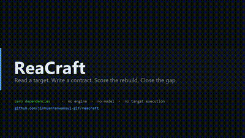

# ReaCraft

[](https://www.npmjs.com/package/reacraft)
[](https://github.com/jinhuanranwansui-gif/reacraft/actions/workflows/ci.yml)
[](https://github.com/jinhuanranwansui-gif/reacraft/releases)
[](LICENSE)
[](package.json)
[](package.json)

[English](README.md) · **中文** · [变更日志](CHANGELOG.md) · [合同与评分口径](docs/CONTRACT.zh.md)

<details>
<summary>目录</summary>

- [三十秒](#三十秒)
- [为什么有这个](#为什么有这个)
- [安装](#安装)
- [用法](#用法)
- [分数到底怎么算](#分数到底怎么算)
- [结构](#结构)
- [面对盾（BLA）](#面对盾bla)
- [商业保护层：Steam DRM、UPX、VMProtect](#商业保护层steam-drmupxvmprotect)
- [指令性的字符串](#指令性的字符串)
- [原版能跑的时候，拿它当 ground truth](#原版能跑的时候拿它当-ground-truth)
- [它不是什么：验证台架](#它不是什么验证台架)
- [接进 CI](#接进-ci)
- [常被问到的几件事](#常被问到的几件事)
- [局限（先说清楚）](#局限先说清楚)
- [自己验一遍](#自己验一遍)
- [许可](#许可)

</details>

读目标 → 写合同 → 重建 → 打分 → 把差额变成下一步。



*GIF 太小就看 [demo.mp4](docs/demo.mp4)——每一帧都是真实命令输出，不是摆拍。*

ReaCraft 站在两个优秀工具的中间，做它们各自都不做的那一段：把静态读取的结果变成**自带验收方式**的义务，按义务给重建打分，再把每个失败翻译成下一轮指令。整条链路留下哈希链记录，事后可以逐条复算。

零依赖。纯 Node，什么都没装也能跑。

## 三十秒

```bash
git clone https://github.com/jinhuanranwansui-gif/reacraft && cd reacraft
node src/cli.mjs all examples/hello/target.txt --name demo --rebuild examples/hello/rebuild
```

示例里的重建是**故意不完整**的。不装任何东西、不调模型、不执行目标，你会拿到：

```text
score    30%   gate=80% → below
items    pass=0 partial=3 fail=2 pending=1   files=1
similar  22% (low confidence, minhash=null)

  partial ob-endpoints   1/2 patterns found
  fail    ob-literals    0/2 patterns found
  partial ob-cap-network 1/2 patterns found
  pending ob-behaviour   needs a human note
```

以及一份可以直接交给重建引擎的下一步指令：

```text
Continue the rebuild of target.txt.
Current score: 30% (gate 80%).
Close these, highest weight first:
- [partial][w5] Add these endpoints to the rebuild config exactly as written: https://cdn.example.test/assets/app.js
- [missing][w4] Reference these exact paths, keys or statements in the rebuild: HKEY_CURRENT_USER, C:\Users\Public\example.cfg
- [human][w2] Record the observed difference between the original and the rebuild …
```

`partial` 按比例给分，`fail` 拿 0 分，`pending` 不进分母。整个过程没有执行任何东西、没有安装
任何东西、没有问过模型——**一个你能自己重算出来的分数，就是全部产品**。

```
read ──▶ spec ──▶ (rebuild) ──▶ verify ──▶ gaps ──▶ (rebuild) ──▶ verify
  │        │                       │          │
profile   义务 + 验收方式          分数 +     给重建引擎的
                                 覆盖度      下一步指令
```

## 为什么有这个

| | [REA](https://github.com/morluto/rea) | [craft-anything](https://github.com/storytold/craft-anything) | ReaCraft |
|---|---|---|---|
| 强项 | 读：100+ 命令，原生/托管/安卓/Web/EVM/WASM/固件，背后是 Ghidra 与 Frida | 重建：驱动编码智能体重构 app、游戏、网站，每轮自检 | 把"读到的"变成可打分的合同，把"分数"变成下一步 |
| 重建 | 不做 | 做（需要编码智能体 + 它自己的项目格式） | 交给 craft-anything 或任何编码智能体 |
| 给重建打分 | 义务台账 + 覆盖评估 | 有，但绑在自己的 rebuild 循环里，且是领域算法（网站像素布局 + SSIM、app 的构建/运行/截图/机制检查） | **不依赖引擎、不依赖工具：任何重建文件夹，从外部打分，不需要项目格式、不需要 LLM、不需要运行时** |
| 失败 → 下一步 | — | 它自己的 builder 按自己的检查迭代 | **`gaps` 直接产出下一轮请求，不管重建是谁做的** |
| 可复算 | 证据导出/导入 | 项目内证据库 | **哈希链台账；`prove` 逐个重算记录过的文件** |
| 需要装引擎 | 需要（深度靠 Ghidra） | 需要（106 MB Rust 二进制） | **不需要** |
| DSH 集成 | MCP 桥插件 | MCP 桥插件 | **原生 Cordis 插件：8 个工具，无桥进程，自带 skill** |

口径说窄一点、也说得可查：两个伙伴都把自己的闭环关在**自己的运行时和项目格式里**；ReaCraft 把闭环放在**合同层**——一堆源码就够，读取可以来自它自己的解析器、REA、或者人；打分既不需要 LLM 也不需要 106 MB 的二进制。它**不试图**在读取广度上超过 REA；对网站重建，craft-anything 的像素/SSIM 比对比字面量覆盖更锐利，这种情况下两边的结果都该看。装了 REA 就 `--deep` 交给它，不跟它抢。

## 安装

一条命令，不用装：

```bash
npx reacraft probe
```

当命令行用：

```bash
npm i -g reacraft        # 或在本仓库 npm link
reacraft probe
```

当 DSH 插件用（8 个工具，没有 MCP 桥）：

```bash
dsh plugin --profile desktop add link:<本仓库绝对路径>
# 重启 DSH —— bundle patch 只在启动时合入
```

插件直接 import 流水线，工具调用不跨进程。

## 用法

```bash
# 1. 读
node src/cli.mjs rea path/to/sample.exe --name sample

# 2. 合同（每条义务自带验收方式）
node src/cli.mjs spec sample --gate 80

# 3. 重建（先 dry run；--run 才真驱动 craft-anything 的编码智能体）
node src/cli.mjs craft sample --run

# 4. 打分并同时拿到差额
node src/cli.mjs verify sample --rebuild build/sample
#    score 30%   gate=80% → below
#    similar 22% (low confidence, minhash=0)
#    pass=0 partial=3 fail=2 pending=1

#    人工义务要签，不要猜；那句话就是它的证据
node src/cli.mjs verify sample --rebuild build/sample --sign 'ob-behaviour=跑了两个，面板文字不同'

# 5. 把差额写回规格，成为下一轮指令
node src/cli.mjs gaps sample --apply

# 6. 报告 + 复算
node src/cli.mjs report sample --html
node src/cli.mjs prove sample
```

退出码：`0` 正常，`1` 用法/IO 错误，`2` 未达门槛或证据链断裂（CI 可以直接用）。

在 DSH 里同样六步是六个工具：`reacraft_read`、`reacraft_spec`、`reacraft_verify`、`reacraft_prove`、`reacraft_report`、`reacraft_status`。

## 分数到底怎么算

两个数分开报，故意不合并——合并会掩盖哪一边弱。

**义务分**：对能判定的义务做加权通过率。权重 1–5；`partial`（比如 12 个符号里命中 8 个）按比例给分；`pending` 完全不计分——**看百分比之前先看 pending 数量**；人工义务不会自己变成 pass。

**集合覆盖**：原目标的词汇有多少进了重建。

| 类别 | 比什么 | 权重 |
|---|---|---|
| endpoints | 主机与 URL 前缀 | 4 |
| literals | 注册表路径、文件路径、SQL、API 路由 | 3 |
| symbols | 导入/导出名，或源码标识符 | 3 |
| structure | manifest 字段、段名、扩展名分布 | 2 |

外加一个基于字面量的 MinHash 估计做交叉参考。

覆盖是"出现过"，不是"行为一致"：一个 URL 出现在注释里也算。报告里写明了，分数是拿来争辩的下限，不是证书。

## 结构

| 文件 | 作用 |
|---|---|
| `src/core/target.mjs` | 格式识别与解析：PE、ELF、Mach-O、APK/JAR/ZIP、ASAR、WASM、脚本 |
| `src/core/rules.mjs` | 所有"这个字面量意味着什么能力"的规则，集中一处可审 |
| `src/core/profile.mjs` | 读取：能力打分、栈猜测、局限、内容派生 evidence id |
| `src/core/spec.mjs` | 合同：能力、带验收方式的义务、结构化重建请求 |
| `src/core/verify.mjs` | 执行义务、加权打分、门槛判定 |
| `src/core/similarity.mjs` | 集合覆盖、Jaccard、MinHash |
| `src/core/gaps.mjs` | 失败 → 下一步指令 |
| `src/core/ledger.mjs` | 哈希链事件日志、`prove` |
| `src/core/report.mjs` | report.md / report.json / report.html |
| `src/core/partners.mjs` | 可选的 REA 与 craft-anything CLI 封装 |
| `src/cli.mjs` | 命令行 |
| `dsh/host/index.js` | DSH 插件：`ctx.tools` 上 8 个工具 |
| `skill/rea-craft/SKILL.md` | 给智能体看的操作手册 |
| `docs/CONTRACT.md` | schema 与评分口径（英文） |
| `docs/CONTRACT.zh.md` | 同上，中文——要跟分数吵架就读这个 |
| `CHANGELOG.md` | 版本之间改了什么（中英对照） |
| `tools/` | 几个独立小工具：`fuzz-guard`、`pe-entropy`、`pe-dump`、`scan-library` |
| `docs/CASE-dsh-asar.md` | 一次真实重建：运行时检查跑不起来，静态检查仍然给了分 |

## 实测踩过的坑（都已修）

- **导入必须精确匹配**，只做 A/W 后缀归一。前缀匹配会把 `SendInput` 认成网络 I/O、把 `SystemParametersInfoA` 认成进程创建。
- **UTF-16 宽串会粘尾字符**（`keychain` → `keychainH`）：用「ASCII 集合 + 去掉尾部 1–2 字符后命中则丢弃」过滤。
- **URL 会粘连**：按第二个 scheme 截断，再按正文标点收尾。
- **Electron 只能结构化判定**（`app.asar`、`chrome_*.dll`），不能看字符串里有没有 "electron"——craft-anything 自己满身这个词。
- **p-code 目标（VB6/Delphi）静态读很薄**，spec 会变短、`unknowns` 会变高；用假义务凑数比承认更糟。
- **失败必须拿 0 分**：第一版把 `fail` 的权重也加进了分子，带失败项的重建能打 100 分。现在是测试里的断言。
- **重跑一个阶段会覆盖产物**，旧记录不该算篡改：最新一条记录对同名产物负责，更早的记为 `superseded`。
- **Windows 下子进程输出别用管道**，sandbox 可能拒绝；写临时文件最稳。

## 面对盾（BLA）

拿 [bla-agents](https://github.com/qybaihe/bla) 的 `bankrupt` 强度（它公开的 crackme v6）实测过。
BLA 的 24 向量矩阵是照着 REA 的预算打的；它有四招，其中三招碰到的是另一种读取器。

| BLA 的招 | 它做什么 | 对 ReaCraft 的效果 |
|---|---|---|
| **Exhaust（耗尽）** | 把输入做到超出分析器预算（256 个候选、32 个 fuse sentinel、16 MiB ASAR 头） | **无效**——这里没有预算可撞，从外面解析、只数数 |
| **Poison（投毒）** | 格式合法的诱饵：假认证清单、蜜罐 source map、重复的假路由 | 骗不了它（它不推理），但**会污染证据**——现在诱饵被标记并从义务里剔除 |
| **Entangle（绑定）** | 兄弟文件 SHA-256 self-seal | 静态读取不受影响；改过的构建会被拒绝加载 |
| **掩码字面量**（`maximum`/`bankrupt`） | 3–256 字符的字面量拆片 + XOR 掩码 | **静态拿不回**——如实报 `present-but-unreadable`，不猜 |

真跑公开 crackme v6（`bankrupt`，`defenseScore: 99`）的结果：

```
detected true (high)   bla-interlock-corpus · bla-generated-symbols ×452 · decoy-narrative ×46 · masked-string-loop
诱饵字段              electron 2×4.5 · anti-analysis 2×4 · mobile 1×11 · licensing 3×2
不可信证据            标记 48 条          endpoints 9 → 3（六个是诱饵）
掩码字面量            present-but-unreadable
```

它给你的不是"破了"的幻觉，而是**量出来的事实**：容器仍然可读，毒被标出来了，静态确实丢掉的那部分
在报告里点名。要拿回掩码字面量，只有两条路——跑起来 hook 解码函数，或把解码函数连同参数抠出来离线求值，
两者都是动态活。

### 掩码字面量是能拿回来的

BLA 的文档说还原 split-share 字面量「要执行解码器：跑程序把变量打出来，或者把函数连同参数从文件里抠出来」。
后半句才是关键：**那两个整数数组就是密钥，而且就放在文件里**。所以它是算术，不是秘密：

```bash
node src/cli.mjs decode samples/hardened-vault.cjs
# 1     0x5d   "TEE_ENCLAVE_MASTER_KEY_c9cd_SLOT_0xc23c89e5"
```

还原式是 `a[i] ^ b[i] ^ ((i * coef) & 0xffff)`，`coef` 从文件自己的解码函数里读出来。
crackme v6 的两个文件（`vault.cjs` 与 `panel.html`）都验证过；普通构建上不会误触发——下面 bench 的
`decode` 两项守着这条。

## 商业保护层：Steam DRM、UPX、VMProtect

在真实的 Steam 库里量的，不是样本。《以撒的结合：重生》带着 SteamStub：

```text
kind     pe-native  arch x86  size 9,537,032
sections .text(7,571,968) .rdata .data .rsrc .reloc .bind(189,960)
entropy  .text 6.56          .bind 7.98
entry    0x00924310  →  在 .bind 里，不在 .text
drm      steam-stub   codeEncrypted=false
```

三个事实，三个结论：

- `.bind` 段熵 7.98，入口点不在 `.text` —— 说明有壳在程序之前接管。`drm.products` 报 `steam-stub`。
- `.text` 熵 6.56 是编译后的代码，不是密文。**这个构建把程序明文发布了**：壳只守启动、存加密的
  stub，代码本身就在那儿。
- 所以义务来自真实程序——`steam_api.dll` 导入、上传端点、Lua 5.3 运行时——而 `ob-drm-scope`
  一句话说清重建欠什么：**启动之后的行为，不是壳**。

如果 `.text` **真被加密**，`codeEncrypted` 为 true、`readable.code` 为 false、`unknowns` 会写代码
必须从运行时 dump 拿。**分数不会假装自己读过根本不存在的字节**——这是"测量一个 DRM"和"糊弄过去"的区别。

检测是结构化的：`.bind`/`.steam`、`UPX0`/`UPX1`、`.vmp*`、`.themida`、`.enigma*`，加上熵阈值和入口点
位置。不单凭产品字符串下结论，普通二进制也不会被扣帽子（这条也有测试守着）。

### 整镜像被加密的时候

同一个库里第二个例子，另一种失效方式。`WardogsClient-Win64-Shipping.exe`（228,536,216 字节）**没有壳段**，
入口点在 `.text` 里，然后：

```text
.text   H=8.00    .rdata H=7.99    .pdata H=8.00    .data H=8.00
_RDATA  H=8.00    .rodata H=7.95   .msvcjmc H=7.96  CPADinfo H=7.95
.rsrc   H=2.86    .reloc  H=5.32                      ← 只剩这两个还是结构
原始字节里 99.9% 是随机的
```

这不是壳。壳会保留 `.pdata` 和重定位表，因为加载器要用；当连编译器标记和异常表都变成随机数时，
**镜像本身被加密或替换过**，没有外部解密器它根本跑不起来。

所以工具只能做唯一诚实的事：

- `drm.imageEncrypted = true`、`readable.code = false`，`unknowns` 写明这个文件本身不是可运行的镜像；
- 合同收缩成**四条人工义务**，第一条是"先有一份可读的镜像，再谈任何行为"；
- 并且把它从那堆字节里抽出来的 **60,026 条"字符串"在同一个 profile 里标成不可信**——随机数据里
  本来就有成千上万段可打印字符，拿它们建分数就是编故事。

最后这一句是整个工具的要点。**一个在输入已经不可读之后还在产出自信结论的读取器，比一个什么
都不说的更糟。**

## 指令性的字符串

[arXiv 2605.30667](https://arxiv.org/abs/2605.30667)（2026 年 5 月）演示了一种**攻击读者而不是二进制**
的手法：把一段程序永远用不到的文本放进字符串常量，读反编译代码或读 strings 的模型会把它当成指令。
程序照常运行，从外面看不出任何异常。

这个工具会把字符串交给模型三次——profile、spec 里引用的样本、报告的证据表——所以它扫**每一条字符串，
不只是 notable 那些**，然后：

- 命中的标 `suspect: 'instruction-like'`，连同命中的规则一起记；
- 永远不让它变成 sample、pattern 或义务；
- 在报告里以打码形式展示（`[instruction-like: Ignore all previous…]`）并附 evidence id，人可以自己去核对字节。

**最危险的那种字符串恰恰不命中任何解析规则**——一句"忽略之前的指令"里没有 URL、没有注册表路径、没有
API 名——所以扫描必须覆盖全部字符串。

## 原版能跑的时候，拿它当 ground truth

地板是"什么都不运行也能算出来的东西"。当原版**确实能跑**时，有更好的答案可拿，所以留了一条路：

```bash
node src/cli.mjs golden sample --from "node dist/sample.js --json"
node src/cli.mjs verify sample --rebuild build/ --against "node build/app.js --json"
```

```text
golden   83%   leaves=6 matched=5 changed=1 missing=0   exit 0
  changed  items[2]: 3 → 4
```

两次运行、两份输出，逐叶子比对：对象和数组摊平成路径（`items[2]`），浮点给 1e-9 的相对容差，
类型变化（`1` 与 `"1"`）算变化。golden 本身进台账，**ground truth 也可审计**。

它不是 GameFrame 那套 Unicorn 台架——比的是打印出来的输出，不是模拟出来的内存。但它把
「字符串看着像」换成「重建打印了 4，原版打印的是 3」，那是另一种强度的主张。

## 覆盖什么，覆盖多深

```bash
node src/cli.mjs map                      # 域表格
node src/cli.mjs map --recipe protection  # 某个域的具体步骤
```

```text
domain            depth    recipes  analyzer
pe-native         full     5        parsePE, profile, drm, decode
pe-managed        partial  3        识别到 CLR 头；IL 未反编译——配 ilspycmd
android           partial  3        从 DEX 名字取类；manifest 未解析——配 apktool
firmware          none     2        无容器解析器：先 binwalk，再逐个 rea
full 5   partial 6   none 1
```

**`depth` 那一列才是重点。** 列出二十种格式却不说到读多深的工具，是在用省略说谎。

- **full** —— 这个仓库能读出结构，并且有对应规则；
- **partial** —— 能打开容器，但真正的工作要靠外部工具，配方里点名是哪个；
- **none** —— 有配方，但没有读取器。

「支持所有逆向域」做不到；**「把同一套方法用到每个域」做得到**。方法——读事实、写合同、打分、差额反哺——
在 PE 和 APK 之间没有任何变化，变的是事实提取器和配方。所以新增一个域是两个文件，不是重写：

1. 一个产出事实的 analyzer（`src/core/target.mjs` 对 PE/ELF/Mach-O/asar 做的就是这件事）；
2. `knowledge/recipes.json` 里的一条，说明跑什么、看什么。

然后在 `src/core/map.mjs` 里设它的 `DEPTH`——表格就会如实说，包括答案是 `none` 的时候。

## 它不是什么：验证台架

[GameFrame](https://tanepiper.github.io/game-frame/) 做的是更难的那件事：用 Unicorn 跑原版自己的函数，
要求移植版**逐位一致**——浮点位、随机数抽取顺序、自带 104 项检查。**只要原版能跑，那就是比任何字符串覆盖都强的
测试，你该用它。**

ReaCraft 量的是"什么都不运行也能看到的东西"。这是更弱的主张，也是唯一可用的主张——当目标跑不起来
（平台不对、要连服务器、带 DRM），或者你不想跑它。两者是互补而不是竞争：模拟出来的 ground truth 是天花板，
这里是永远算得出来的地板。

这不是空谈。[docs/CASE-dsh-asar.md](docs/CASE-dsh-asar.md) 记了一次真实重建：craft-anything 自己的
运行时检查在这台机器上**根本跑不起来**（Electron 启动即崩，`0xC0000005`），构建停在 exit 1——
而静态合同那边仍然打了 100%。两个答案同时为真：程序没法被观察，而代码是对的代码。

## 接进 CI

重建漏掉一条义务，是那棵树的缺陷，所以它也该是一条 SARIF 结果：

```bash
node src/cli.mjs verify sample --rebuild build/sample --sarif reacraft.sarif
```

`fail` → `error`，`partial` → `warning`，`pending` → `note`；每条 rule 带权重、验收方式和 evidence id。
把文件丢进 GitHub code scanning，分数就贴在 PR 旁边。

懒得接线也行，这个仓库本身就是一个 composite action：

```yaml
- uses: actions/checkout@v4
- uses: jinhuanranwansui-gif/reacraft@v0.11.0
  with:
    target: samples/target.bin
    rebuild: build/
    gate: 85
```

分数写进 job summary，低于门槛就失败，有 `security-events: write` 就把 SARIF 传上去。

## 常被问到的几件事

**「为什么不直接用 REA？」** 读的时候该用。REA 是 241 个 MCP 工具，背后是 Ghidra、IDA、Frida 和
十几个引擎；凡是有解析器的目标，它读得比这里深。`reacraft rea <目标> --deep` 就是把深读交给它，
并保留它的证据。ReaCraft 加的是**读完之后那一层**：带验收方式的义务、分数、修复计划。

**「为什么不直接用 craft-anything？」** 重建的时候也该用。把 `verify --rebuild` 指向
`<craft 项目>/app`，你就拿到对 craft 产物的外部评分。它对网站的检查（像素、布局）更锐利；
这里的评分对任何一棵树都成立，包括人手写的那棵。

**「100% 是不是说明重建对了？」** 不是。它说明所有**能判定**的义务都满足了。人工义务要有人签，
`pending` 不进分母，覆盖度数的是"出现过"而不是"行为一致"。精确规则在 `docs/CONTRACT.zh.md`。

**「它会执行我的目标吗？」** 不会。解析器不会，评分器不会，`decode` 也不会——还原掩码字面量是
对文件自己携带的整数数组做算术。唯一的子进程是两个可选的伙伴 CLI，而且只有你传 `--deep` 或
`--run` 时才会发生。

**「为什么坚持零依赖？」** 因为一个只读文件的工具，应该能在任何 CI、任何系统上跑，不需要
106 MB 下载，也不需要折腾 Node 版本。`node --test`、`bench` 和这里每条命令都能在 Node 18 上
零安装跑。

**「能读什么？」** PE（导入、导出、延迟导入、签名、overlay）、ELF（段、dynsym、DT_NEEDED、
interpreter）、Mach-O（段、dylib、fat 检测）、APK / JAR / ZIP、Electron ASAR（manifest、
integrity）、WASM、`.pyc`、纯脚本。它读**容器**，不做反汇编。

**「加壳/加密的目标呢？」** 容器仍然可读——盾是加字节，不是重写结构。`shield` 会说明它认出了什么、
把诱饵标出来、把掩码字面量报成"已还原"或"读不到"。`decode` 处理 split-share 这一种构造；
别的构造不猜。

## 局限（先说清楚）

- 只做静态。不执行目标。行为是人来签的义务。
- 没有反汇编、没有反编译器、没有 Ghidra：需要就装 REA 用 `--deep`。
- 相似度是集合覆盖，不是等价。
- APK 只到 zip 索引与 dex 类描述符，不解 manifest。
- 固件、EVM、WASM 内部：不在范围内（REA 覆盖，把它的产物当补充证据传进来）。
- 重建本身不在这个仓库里，是设计决定：`craft` 把请求交给 craft-anything，任何接受这个请求的编码智能体都行。

## 自己验一遍

```bash
node --test                    # 19 个测试，无外部样本，无网络
node src/cli.mjs bench         # 整条主张，端到端，全用生成的样本
node src/cli.mjs selftest      # 读 → 规格 → 打分 → 差额 → 篡改检测
```

`bench` 是「要不要信它」该跑的那条：

```
reacraft bench — 16/16 in 72ms
PASS read-format · read-evidence · read-stable
PASS spec-obligations
PASS verify-partial · verify-improves · verify-similarity
PASS gaps-request
PASS ledger-intact · ledger-tamper
PASS shield-detect · shield-decoy
PASS decode-recover · decode-no-exec
PASS sarif-shape · report-markdown
```

### 真跑过一次

`default_app.asar`（DSH 自带的 Electron 默认应用）：读 → 出合同 → 交给 craft-anything 用
DeepSeek 后端重建 → 从外部打分：

```
score 100%  gate=80% → pass        pass=5 partial=0 fail=0 pending=1
similar 67% (medium confidence)
  pending ob-behaviour   需要人签
```

第一次是 96%，唯一的 `partial` 缺的是
`https://nodejs.org/docs/v${process.versions.node}/api`——原文里的模板字符串，任何重建都不可能
逐字含有。那次跑出来的就是这个规则：模板 URL 只作证据，不作要求。

## 许可

MIT。思路来自 [REA](https://github.com/morluto/rea)（MIT）与 [craft-anything](https://github.com/storytold/craft-anything)（MIT OR Apache-2.0）；没有拷贝它们的代码，两者都通过各自的 CLI 调用。
